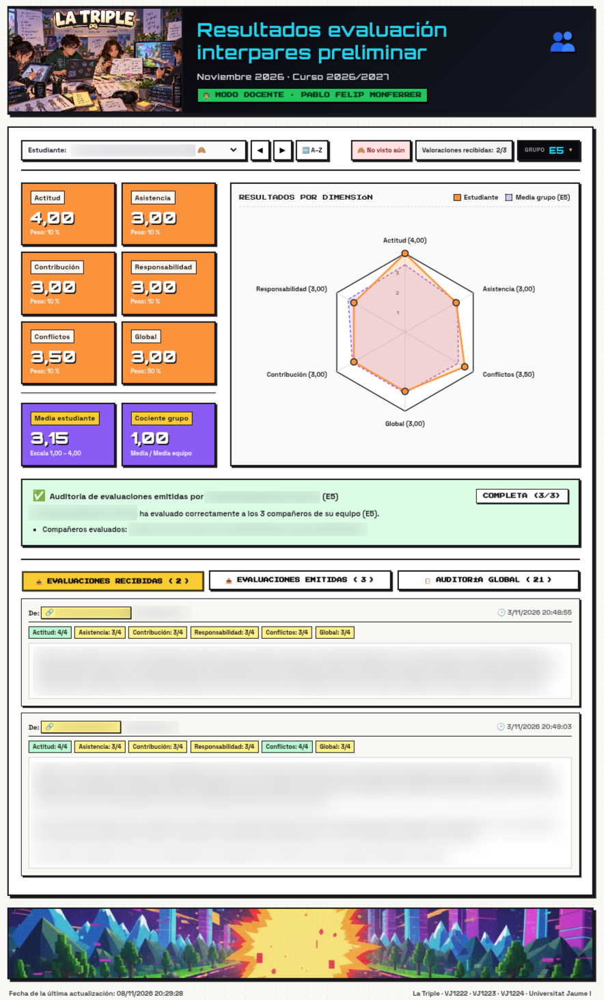
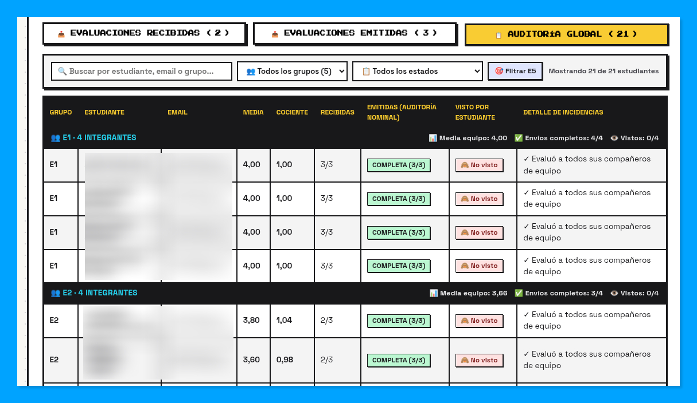
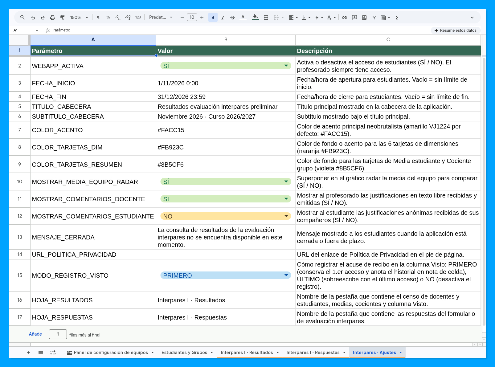

# La Triple · WebApp de Evaluación Interpares (Apps Script)

Aplicación web desarrollada en **Google Apps Script** (confinada a Google Sheets) para comunicar de forma individualizada, auditada y segura los resultados de la evaluación interpares del proyecto grupal conjunto de las asignaturas del Grado en Diseño y Desarrollo de Videojuegos de la **Universitat Jaume I (UJI)**:

- **VJ1222** · Diseño Conceptual de Videojuegos
- **VJ1223** · Arte del Videojuego
- **VJ1224** · Ingeniería del Software

  

## ✨ Funcionalidades destacadas

- **Doble vista adaptada al rol (*Estudiante* / *Docente*)**: identificación automática mediante la cuenta institucional `@uji.es` contrastada con el censo del curso, ofreciendo a cada estudiante exclusivamente su informe individual y al equipo docente las herramientas completas de supervisión.
- **Panel visual multidimensional y comparativa de grupo**:
  - Tarjetas detalladas para las **6 dimensiones evaluadas** (*Contribución*, *Actitud*, *Responsabilidad*, *Asistencia*, *Conflictos* y *Global* en escala 1–4) con indicador de posición respecto a la media de su equipo.
  - Tarjetas de síntesis con la **media global de las dimensiones** y el **cociente de contribución al grupo** (factor multiplicador sobre el rendimiento medio del equipo).
  - **Gráfico radar hexagonal (*Kiviat*)** interactivo en SVG que superpone el perfil individual del estudiante frente al polígono promedio de su equipo.
- **Modo Docente e inspección integral**:
  - Selector desplegable de estudiantes con conmutador de orden (**`🔤 A–Z`** alfabético ↔ **`👥 Grupo`** agrupado por equipos), botones de navegación rápida (`◀` / `▶`), etiquetas de estado en tiempo real (*Visto* / *No visto aún* y valoraciones recibidas) y **menú desplegable (*popover*) en el badge de `Grupo`** para saltar en un clic a cualquier compañero del mismo equipo.
  - Consulta en pestañas independientes de las **evaluaciones recibidas** por el alumno seleccionado (con autoría, desglose por dimensión y comentarios cualitativos) y de las **evaluaciones emitidas** a sus compañeros, con **nombres clicables** para saltar directamente a la ficha de cualquier evaluador o evaluado.
  - **Verificación de integridad en vivo**: contraste automático entre las métricas precalculadas en la hoja `Interpares I · Resultados` y el recálculo dinámico a partir de las respuestas brutas, alertando de cualquier discrepancia.
- **Auditoría global del curso**:
  - Tabla de auditoría **agrupada por equipo** (con fila resumen por grupo de nº de integrantes, media del equipo, envíos completos y lecturas confirmadas) y ordenada alfabéticamente dentro de cada equipo.
  - **Barra de búsqueda instantánea y filtros combinados** (por texto libre, por grupo o equipo del alumno actual y por estado de entrega o lectura) que detecta automáticamente **entregas faltantes o parciales, envíos duplicados, evaluaciones cruzadas a miembros de otros grupos y autoevaluaciones omitidas**, con salto directo a la ficha de cada estudiante en un clic.

  

- **Parametrización granular en caliente desde Google Sheets**:
  - Pestaña `Interpares · Ajustes` que permite gobernar la aplicación sin tocar el código ni volver a desplegar: interruptor general de activación (`WEBAPP_ACTIVA`), ventana automática de apertura y cierre por fecha/hora (`FECHA_INICIO`, `FECHA_FIN`), nombres de pestañas (`HOJA_RESULTADOS`, `HOJA_RESPUESTAS`), títulos, colores corporativos, visibilidad de comentarios cualitativos para docentes/estudiantes y política de registro de visitas (`MODO_REGISTRO_VISTO`).
- **Trazabilidad automática de lectura (`Visto`)**:
  - Registro automático de la fecha y hora de consulta en la columna `Visto` cuando un estudiante accede a sus resultados (configurable para conservar la primera visita, actualizar con la última o desactivar el registro) y bitácora acumulada en la nota de la celda (primera visita, última visita y número total de accesos).
- **Impersonación multiusuario para depuración (`DEBUG`)**:
  - Permite al desarrollador/docente simular en [`Code.gs`](Code.gs) o [`Index.html`](Index.html) el acceso con el correo de cualquier estudiante, docente o usuario ajeno al curso para verificar qué ve exactamente cada perfil sin ensuciar el registro real de visitas (`Visto`).

---

## 🔒 Arquitectura de seguridad y prevención de fugas de información

Esta aplicación se ha diseñado aplicando buenas prácticas de seguridad en Google Apps Script (*Defense in Depth* y *Zero Trust* respecto al cliente) para garantizar la confidencialidad de las calificaciones y el anonimato entre compañeros:

1. **Principio de mínimo privilegio (`@OnlyCurrentDoc` y `oauthScopes` restringidos)**:
   - El código de servidor ([`Code.gs`](Code.gs)) declara la directiva JSDoc `@OnlyCurrentDoc` y el manifiesto ([`appsscript.json`](appsscript.json)) limita explícitamente los permisos OAuth a `spreadsheets.currentonly` y `userinfo.email`.
   - De este modo, el script **solo tiene permiso para leer y escribir en la hoja de cálculo contenedora en la que se aloja**, sin acceso a ningún otro archivo de Google Drive de la cuenta que despliega la aplicación.

2. **Desacoplamiento de permisos sobre la hoja de cálculo (`executeAs: USER_DEPLOYING` + `access: DOMAIN`)**:
   - Los estudiantes **no necesitan permisos de lectura ni de edición** sobre el archivo de Google Sheets que almacena las respuestas originales.
   - El acceso a la aplicación web está restringido al dominio institucional de la Universitat Jaume I (`@uji.es`) y se ejecuta bajo el contexto controlado del despliegue.

3. **Seguridad a nivel de fila (*Row-Level Security*, RLS) estricta en el Backend**:
   - La identidad del usuario nunca se confía al navegador ni a parámetros del DOM: se verifica en el servidor mediante `Session.getActiveUser().getEmail()`.
   - **Filtrado en origen para estudiantes (`sanitizeStudentReportForStudent_`)**: cuando accede un estudiante, el servidor construye y serializa **exclusivamente** su propio registro agregado. El navegador del estudiante jamás recibe el listado de otros alumnos, ni las calificaciones de sus compañeros, ni la identidad de quién emitió cada valoración. Aunque un usuario manipule el DOM o invoque manualmente `google.script.run.getAppData({ targetEmail: 'otro@uji.es' })` desde la consola de desarrollo del navegador, el backend ignora `targetEmail` al comprobar que su rol real es `Estudiante`.

4. **Encapsulación de funciones internas (sufijo `_`)**:
   - En Google Apps Script, toda función global sin guion bajo final queda expuesta a ser invocada desde el cliente mediante `google.script.run`.
   - Por seguridad, **todas las funciones de lectura de datos, cálculo, saneamiento y escritura están declaradas como privadas con el sufijo `_`** (`readSettings_`, `readRoster_`, `readResponses_`, `computeAllMetrics_`, `buildStudentSubmissionAudit_`, `recordStudentSeenTimestamp_`, `sanitizeStudentReportForStudent_`, `sanitizeStudentReportForTeacher_`, etc.).
   - Únicamente existen dos puntos de entrada públicos: `doGet(e)` y `getAppData(clientRequest)`.

5. **Prevención de inyección XSS y gestión de errores sin alertas nativas**:
   - Todos los textos procedentes del formulario o de la hoja de cálculo se escapan en el cliente mediante `escapeHtml()` antes de insertarse en el DOM.
   - Si un usuario autenticado en el dominio `@uji.es` no pertenece al censo de la asignatura (ni como estudiante ni como docente), o si intenta acceder fuera del plazo configurado en `Interpares · Ajustes`, el backend devuelve únicamente el código de estado (`UNAUTHORIZED` o `CLOSED`) sin exponer datos del curso, mostrándose una pantalla de aviso estilizada (sin `alert()` de JavaScript).

6. **Registro inmutable de auditoría de lectura (columna `Visto`) protegido frente a pruebas**:
   - Cuando un estudiante real accede a consultar sus resultados, el backend registra automáticamente la marca temporal (`dd/MM/yyyy HH:mm:ss`) en la columna `Visto` (I) de `Interpares I · Resultados` y almacena el historial de visitas (primer acceso, último acceso y recuento total) en la nota de la celda.
   - Cuando el profesorado utiliza el modo de impersonación (`DEBUG`) para verificar la vista de un alumno, **el backend bloquea la escritura automática en la columna `Visto`** para no alterar la trazabilidad real de acceso del estudiantado.

7. **Modo `DEBUG` e impersonación multiusuario en código**:
   - Se incluye un objeto global `DEBUG = { enabled: false, email: '' }` tanto en [`Code.gs`](Code.gs) como en [`Index.html`](Index.html), desactivado por defecto en producción y sin controles interactivos ni desplegables de usuarios expuestos en la interfaz.
   - Para depurar o auditar la vista de cualquier rol (docente, estudiante o usuario no autorizado), el creador de la aplicación puede establecer temporalmente `enabled: true` e indicar el correo a simular en `email` directamente en [`Code.gs`](Code.gs) o [`Index.html`](Index.html) (mostrándose en ese caso una banda informativa de impersonación activa).

---

## 📊 Estructura de pestañas en Google Sheets

> [!NOTE]
> El funcionamiento de la WebApp requiere estar vinculada a una hoja de cálculo de Google Sheets con una estructura específica de pestañas y columnas. Dada la naturaleza particular de la evaluación interpares que se desarrolla en este proyecto conjunto de creación de videojuegos, se ha optado por no publicar una plantilla de la hoja de cálculo; no obstante, **cualquier agente de IA puede inferir y reconstruir su estructura exacta de forma inmediata a partir de la lectura de [`Code.gs`](Code.gs)** (funciones `readSettings_`, `readRoster_` y `readResponses_`), cuyo esquema se resume a continuación.

- **`Interpares I · Resultados`**: Censo de docentes y estudiantes (`Equipo`, `Nombre`, `Apellidos`, `Email`, `Tipo`, `Media estudiante`, `Cociente grupo`, `Respuestas`, `Visto`), donde el campo **`Visto`** almacena un valor de **fecha y hora** (`dd/MM/yyyy HH:mm:ss`) registrado automáticamente cuando el estudiante consulta sus resultados (junto con el historial de visitas en la nota de la celda).
- **`Interpares I · Respuestas`**: Respuestas del formulario con las 6 dimensiones (*Contribución*, *Actitud*, *Responsabilidad*, *Asistencia*, *Conflictos*, *Global*) en escala de 1 a 4 (`DEFICIENTE = 1`, `REGULAR = 2`, `BUENO = 3`, `EXCELENTE = 4`) y justificación cualitativa.
- **`Interpares · Ajustes`**: Tabla clave-valor para parametrizar en caliente el comportamiento de la aplicación sin tocar el código:
  - `WEBAPP_ACTIVA` (`SÍ` / `NO`): activa o desactiva el acceso de estudiantes (el profesorado siempre tiene acceso).
  - `FECHA_INICIO` (`DD/MM/YYYY HH:MM` o `YYYY-MM-DD HH:MM`): fecha y hora de apertura para estudiantes (vacío = sin límite de inicio).
  - `FECHA_FIN` (`DD/MM/YYYY HH:MM` o `YYYY-MM-DD HH:MM`): fecha y hora de cierre para estudiantes (vacío = sin límite de fin).
  - `TITULO_CABECERA`: título principal mostrado en la cabecera de la aplicación.
  - `SUBTITULO_CABECERA`: subtítulo mostrado bajo el título principal.
  - `COLOR_ACENTO`: color de acento principal neobrutalista (por defecto `#FACC15`).
  - `COLOR_TARJETAS_DIM`: color de fondo o acento para las 6 tarjetas de dimensiones (por defecto `#FB923C`).
  - `COLOR_TARJETAS_RESUMEN`: color de fondo para las tarjetas de *Media estudiante* y *Cociente grupo* (por defecto `#8B5CF6`).
  - `MOSTRAR_MEDIA_EQUIPO_RADAR` (`SÍ` / `NO`): superponer en el gráfico radar la media del equipo para comparar.
  - `MOSTRAR_COMENTARIOS_DOCENTE` (`SÍ` / `NO`): mostrar al profesorado las justificaciones en texto libre recibidas y emitidas.
  - `MOSTRAR_COMENTARIOS_ESTUDIANTE` (`SÍ` / `NO`): mostrar al estudiante las justificaciones anónimas recibidas de sus compañeros.
  - `MENSAJE_CERRADA`: mensaje mostrado a los estudiantes cuando la aplicación está cerrada o fuera de plazo.
  - `URL_POLITICA_PRIVACIDAD`: URL del enlace de Política de Privacidad en el pie de página.
  - `MODO_REGISTRO_VISTO` (`PRIMERO` / `ÚLTIMO` / `NO`): política de registro de fecha/hora en la columna `Visto` (`PRIMERO` conserva el 1.er acceso y anota el historial en nota de celda; `ÚLTIMO` sobrescribe con el último acceso; `NO` desactiva el registro).
  - `HOJA_RESULTADOS`: nombre de la pestaña que contiene el censo de docentes y estudiantes, medias, cocientes y columna `Visto` (por defecto `Interpares I · Resultados`).
  - `HOJA_RESPUESTAS`: nombre de la pestaña que contiene las respuestas del formulario de evaluación interpares (por defecto `Interpares I · Respuestas`).

  

---

## 🚀 Instalación y despliegue en Google Apps Script

### 1. Cargar los archivos en el proyecto de Apps Script

> [!TIP]
> **Recursos gráficos autocontenidos**: No es necesario subir la carpeta `assets/` a Google Apps Script. Las ilustraciones de cabecera y faldón ya están optimizadas en formato WebP e incrustadas en Base64 dentro de [`Index.html`](Index.html) (los archivos originales [`assets/encabezado.png`](assets/encabezado.png) y [`assets/faldon.png`](assets/faldon.png) se conservan en el repositorio únicamente como material fuente de referencia).

#### Opción A: Manualmente desde el editor web de Google Sheets *(recomendada para instalación rápida)*

1. Abre tu hoja de cálculo en Google Sheets y ve a **Extensiones → Apps Script**.
2. En el archivo `Código.gs` (o `Code.gs`), pega el contenido íntegro de [`Code.gs`](Code.gs).
3. Haz clic en el botón **+** (*Añadir un archivo*) → **HTML**, nómbralo exactamente **`Index`** (sin escribir `.html`) y pega el contenido íntegro de [`Index.html`](Index.html).
4. *(Opcional)* Si deseas aplicar el manifiesto explícito, activa *«Mostrar el archivo de manifiesto "appsscript.json" en el editor»* en **Configuración del proyecto (⚙️)** y pega el contenido de [`appsscript.json`](appsscript.json).

#### Opción B: Sincronización con GitHub mediante *Google Apps Script GitHub Assistant*

Dado que la extensión solo lista repositorios pertenecientes a la cuenta de GitHub autenticada:

1. Haz primero un **Fork** de este repositorio en tu propia cuenta de GitHub.
2. Instala la extensión [Google Apps Script GitHub Assistant](https://chromewebstore.google.com/detail/google-apps-script-github/lfjcgcmkmjjlieihflfhjopckgpelofo) en Chrome y vincúlala con tu cuenta de GitHub.
3. Abre tu hoja de cálculo en Google Sheets y ve a **Extensiones → Apps Script**.
4. En la barra superior del editor de Apps Script, selecciona tu *fork* (`<tu-usuario>/vj1224-interpares`) y la rama `main`, y haz clic en **Pull** para descargar [`Code.gs`](Code.gs), [`Index.html`](Index.html) y [`appsscript.json`](appsscript.json).

### 2. Publicar como aplicación web

1. En el editor de Apps Script, pulsa en **Implementar → Nueva implementación**:
   - Tipo: **Aplicación web**
   - Ejecutar como: **Yo** *(propietario/desplegador del script)*
   - Quién tiene acceso: **Cualquier usuario de tu organización / dominio institucional** *(p. ej., Universitat Jaume I · `uji.es`)*
2. Autoriza los permisos (restringidos exclusivamente al documento actual gracias a `@OnlyCurrentDoc`) y comparte el enlace de la aplicación web con el estudiantado.

